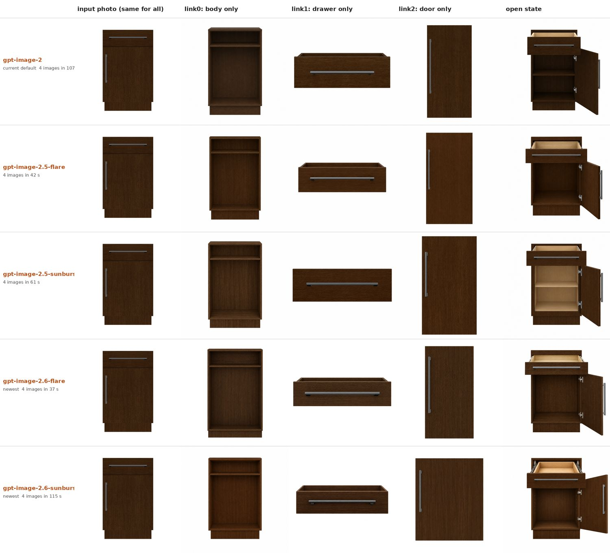
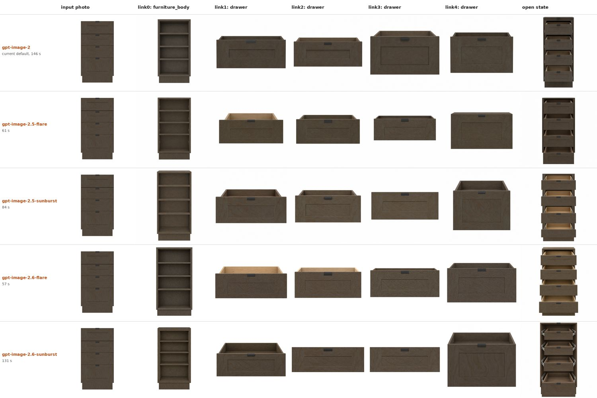
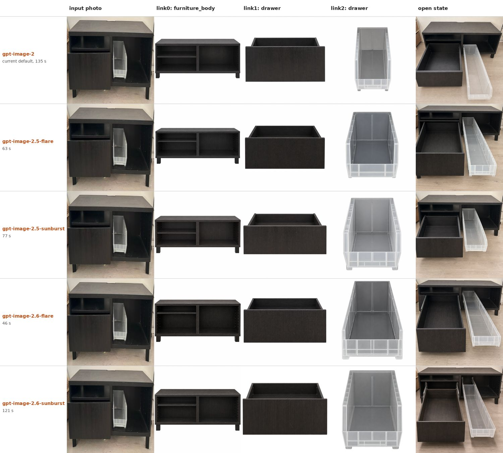
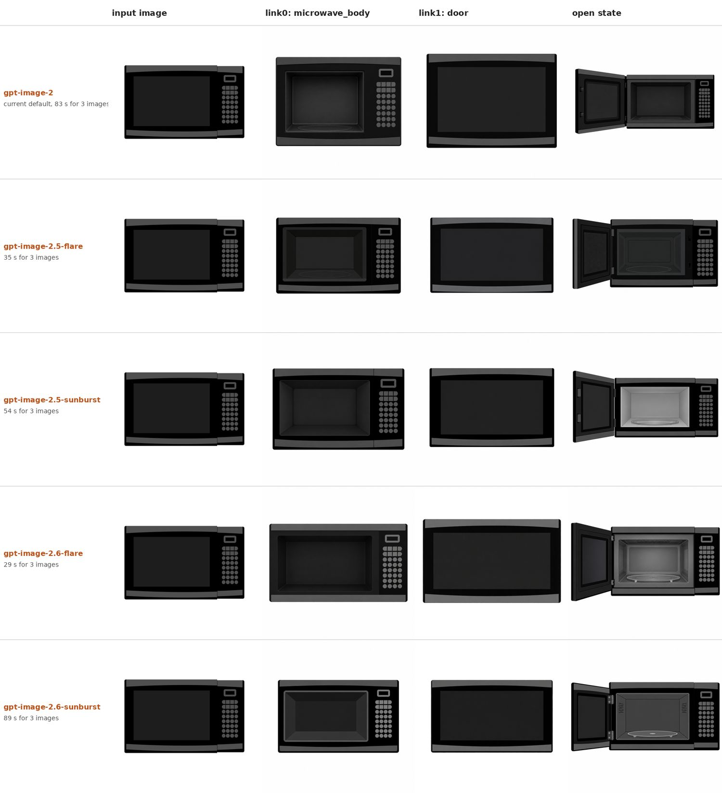
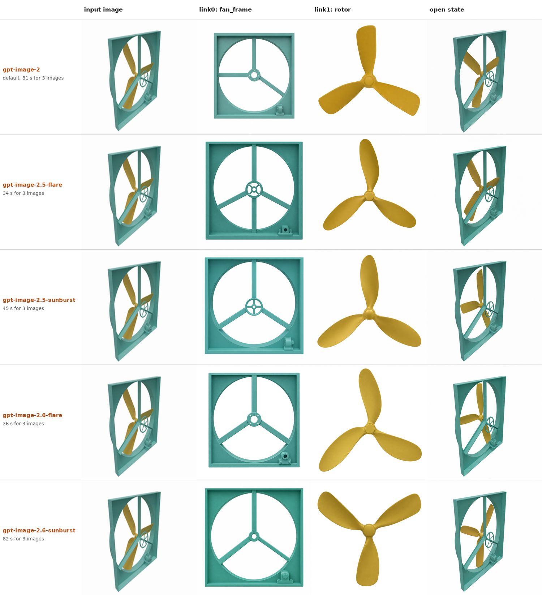

# Image model comparison for part and open-state image generation

Date: 2026-11-13. Scope: pipeline steps 5 (per-part images) and 8b (open-state image) only.

## Summary

- All five OpenAI image models tested work with the pipeline code unchanged.
- The default image model is now `gpt-image-2.6-sunburst`, chosen for image detail and fidelity to the input. It replaces `gpt-image-2`, which had a wrong part on four of the five objects.
- `gpt-image-2.6-sunburst` is as slow as `gpt-image-2` (about 28 s per image) and drew drawers as flat front panels on one object. `gpt-image-2.6-flare` had no wrong part on any object and is about three times faster; it is the alternative to try if speed or drawer shape matters.
- The 2.5 generation uses about a quarter of the output tokens of `gpt-image-2`.
- Any model can be selected with the `SPARK_OPENAI_IMAGE_MODEL` environment variable.

This is one sample per image, so the quality findings are indicative, not conclusive.

## Setup

- Models: `gpt-image-2`, `gpt-image-2.5-flare`, `gpt-image-2.5-sunburst`, `gpt-image-2.6-flare`, `gpt-image-2.6-sunburst`.
- Objects: PartNet-Mobility 45162 (cabinet, drawer + door), 46893 (four-drawer cabinet), 7236 (microwave), 101220 (box fan), and a real photo of a TV stand (drawer + storage bin).
- Each model received the same input image and the same prompts (`prompt_part.json`, `prompt_open.json`), generated once per object.
- Images were generated with `VLMguidance/generate_image_part.py` and `VLMguidance/generate_image_open.py`, quality `medium`, size `1024x1024`, through the OpenAI API.
- 20 images per model: 4 + 6 + 4 + 3 + 3.

## Results

### Quality

| Model | 45162 cabinet | 46893 four drawers | TV stand photo | 7236 microwave | 101220 fan | Objects with a wrong part |
|---|---|---|---|---|---|---|
| `gpt-image-2` | door too narrow | correct | storage bin too narrow | body too tall and square | frame spokes wrong | 4 of 5 |
| `gpt-image-2.5-flare` | correct | one drawer is a solid block | correct | correct | frame has extra spokes | 2 of 5 |
| `gpt-image-2.5-sunburst` | drawer is a flat front only | one drawer is a flat front only | correct | correct | correct, most faithful | 2 of 5 |
| `gpt-image-2.6-flare` | correct | correct | correct | correct, cavity shallow | correct | 0 of 5 |
| `gpt-image-2.6-sunburst` | door too wide | two drawers are flat fronts only | correct | correct, most faithful | correct | 2 of 5 |

A part drawn as a flat front panel has no box behind it, so step 6 would reconstruct a wrong 3D shape for it.

### Tokens and time, per image

Input tokens are about 1,400 per image for every model (same reference image and prompt).

| Model | Output tokens | 45162 | 46893 | TV stand | 7236 | 101220 | Average time |
|---|---|---|---|---|---|---|---|
| `gpt-image-2` | 1,756 | 27 s | 29 s | 34 s | 28 s | 27 s | about 29 s |
| `gpt-image-2.5-flare` | 439 | 11 s | 12 s | 16 s | 12 s | 11 s | about 12 s |
| `gpt-image-2.5-sunburst` | 439 | 15 s | 17 s | 19 s | 18 s | 15 s | about 17 s |
| `gpt-image-2.6-flare` | 1,449 | 9 s | 11 s | 12 s | 10 s | 9 s | about 10 s |
| `gpt-image-2.6-sunburst` | 1,449 | 29 s | 26 s | 30 s | 30 s | 27 s | about 28 s |

- Output tokens depend only on the model generation. `flare` and `sunburst` of the same generation use identical token counts.
- Time depends mainly on the variant. `flare` is fast in both generations; `2.6-sunburst` is as slow as `gpt-image-2`.

## Comparison sheets

Rows are models. Columns are the input image, each part image, and the open-state image.











## Limitations

- One sample per image. Image models vary between runs: a repeat of the fan with `gpt-image-2` gave a correct frame and a lopsided rotor, the reverse of the sheet above.
- Only the generated images were compared. The effect on the final 3D meshes (step 6) was not measured.
- The five models ran in parallel, so the times reflect API load at that moment and are approximate.
- Token counts are not cost. Per-token prices may differ between models; check the OpenAI usage page for actual spend.

## How to use another model

```bash
SPARK_OPENAI_IMAGE_MODEL=gpt-image-2.6-flare python run.py
```
